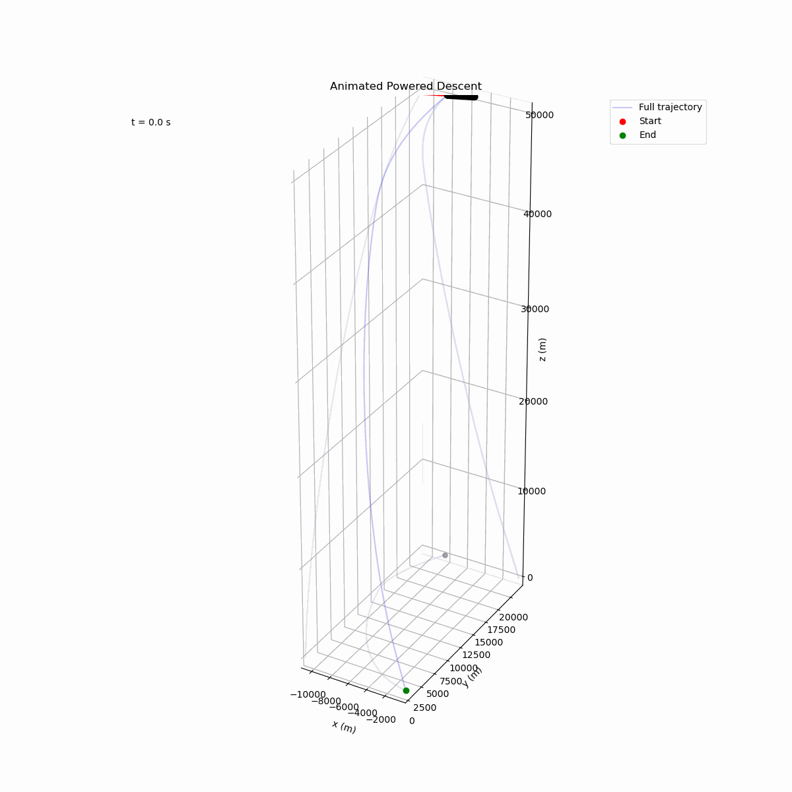

# Nonlinear Trajectory Optimization
Implements and simulates trajectory optimization for a nonlinear powered descent guidance (PDG) problem.

* Discretization of the system dynamics is implemented via Hermite–Simpson direct collocation, and the resulting nonlinear program (NLP) is solved using the IPOPT nonlinear interior-point solver.
* System dynamics include nonlinear spherical gravity, drag, and variable mass.
* Variable scaling is applied throughout to greatly improve optimization convergence speed and reliability.
* A lossless convex relaxation is applied to the non-convex thrust constraint.
* By default, initial trajectory guesses are computed using a ZEM/ZEV (Zero-Effort-Miss/Zero-Effort-Velocity) guidance law, but if desired, a much more crude straight-line approximation can also be used.

## Example Trajectory Output

## Future Improvements
0) Plot the planet's surface near the landing site, and add a simpler linear surface constraint instead of a radial constraint
1) Add a glide-slope constraint near the landing site
2) Use polynomial trajectories for states and controls that match the collocation method
3) Implement additional collocation methods
4) Add planetary rotation
5) Reorder functions to make the code flow easier to read
6) Add 6-DOF dynamics