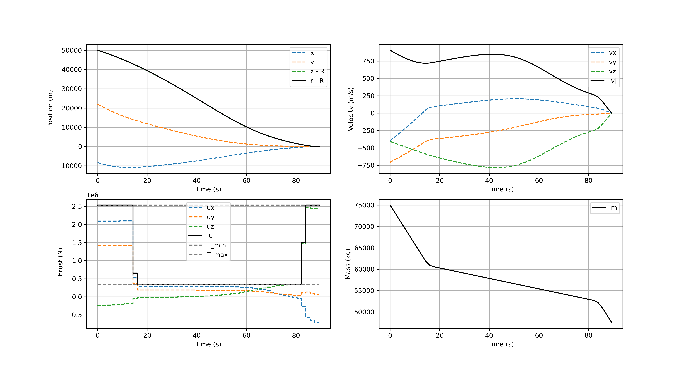
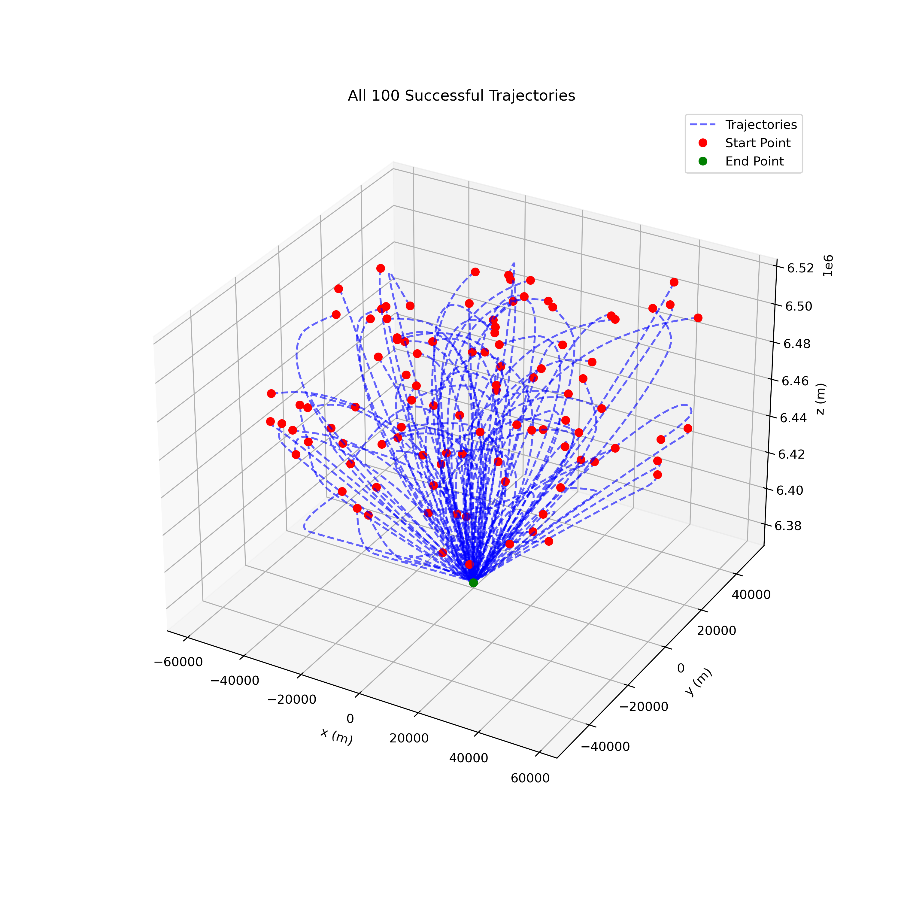

# Nonlinear Trajectory Optimization
Implements and simulates trajectory optimization for a nonlinear powered descent guidance (PDG) problem.

* Currently available trajectory optimization methods include:
    * Nonlinear optimization via **Hermite-Simpson** direct collocation and IPOPT
    * Line search optimization via **Zero-Effort-Miss/Zero-Effort-Velocity** (ZEM/ZEV)

* Additional notes of interest:
    * **System dynamics** include nonlinear spherical gravity, drag, and variable mass.
    * **Variable scaling** is applied throughout to greatly improve optimization convergence speed and reliability.
    * A **lossless convex relaxation** is applied to the non-convex thrust constraint.
    * **Initial trajectory guesses** are computed using a ZEM/ZEV (Zero-Effort-Miss/Zero-Effort-Velocity) guidance law by default, but if desired, a much more crude straight-line approximation can also be used.
    * **Monte Carlo**-based initial condition sampling can be used to evaluate the robustness of the generated trajectories.

## Example Trajectory Output

## Example Monte Carlo Trajectory Output

## Future Improvements
1) Implement additional collocation methods
2) Plot the planet's surface near the landing site, and add a simpler linear surface constraint instead of a radial constraint
3) Add a glide-slope constraint near the landing site
4) Use polynomial trajectories for states and controls that match the collocation method
5) Add planetary rotation
6) Reorder functions to make the code flow easier to read
7) Add 6-DOF dynamics
8) Add statistical plots for Monte Carlo trajectory generation (currently, trajectory statistics are only printed to the terminal)